# notebooks — 演習の実行結果まとめ

> 🔰 **はじめての方へ**: まず [00_basics.ipynb](00_basics.ipynb) を読んでください。予備知識ゼロから、基礎知識・小さな実験・用語集・読む順をまとめてあります。各Notebookの冒頭にも「やさしい導入」を置いています。

**強化学習**（正解を教わらず、報酬だけを手がかりに、行動を学ぶ）を、小さな迷路・棒立て（CartPole）・家庭用蓄電池の制御で学ぶ演習です。7本のNotebook（00〜06）で、環境も学習器も**自作**しながら進めます。
このページは、各Notebookを**実行したときに何が起こり、何が分かるか**を、結果の図・表つきでまとめたものです。
**Notebookを開く前の予習**にも、**実行後の答え合わせ**にも使えます。

> 🔒 すべて**自作のシミュレータ**と**合成データ**です。実在の個人のデータは使っていません。数字は**考え方を学ぶためのもの**で、実運用の性能ではありません。

## このページの見方

- 図・表の数値は、各Notebookを**実行したときの出力**です。乱数のシードを固定しているので、**同じ数値になります**（環境やライブラリのバージョンで、小数点以下が少しずれることはあります）。
- 強化学習は**乱数でぶれやすい**ので、特に断りがなければ、**10個のシードの平均**です。`sd`（`±`）は**シード間のばらつき**で、**手法の差がこれより小さいときは、差があるとは言えません**。
- **学習中の成績**（探索しながら動いたとき）と、**学習後の方策の成績**（探索をやめて動かしたとき。学習とは別の乱数）は、**別のもの**です。
- **リターン**は、1回の挑戦での報酬の合計です。迷路では、1歩ごとに −1 なので、**0に近いほど良い**（−8 は8歩で着いた）。CartPole は倒れずにもった歩数（満点200）。蓄電池は −電気代 で、このページでは円/日で表します（**小さいほど良い**）。
- 用語が分からないときは、すぐ下の「用語集」を見てください。
- 詳しい考察は [../MANUAL.md](../MANUAL.md)、最終レポートは [../REPORT.md](../REPORT.md) にあります。
- 04 の結論（離散化がDQNより強い）は、**06の最終評価で見直されました**。両方を合わせて読んでください。

## 用語集

分からなくなったら、ここに戻ってきてください。

### 強化学習の基本

| 用語 | やさしい説明 |
|---|---|
| **エージェント** | 行動して、学ぶ側（学習するプログラム） |
| **環境** | エージェントが行動する相手（迷路・棒立て・家と蓄電池）。ここでは、すべて自作のシミュレータ |
| **状態 s** | 今の状況（迷路ならどのマスにいるか、CartPole なら台車と棒の位置・速度・角度） |
| **行動 a** | できること（迷路なら上・右・下・左、蓄電池なら待機・充電・放電） |
| **報酬 r** | 行動の結果として返ってくる点数。エージェントは、**報酬の合計（リターン）を大きく**しようとする |
| **方策** | 状態から行動を決める規則。学習で得たいもの |
| **エピソード** | スタートから、ゴール（または打ち切り）までの1回の挑戦 |
| **教師あり学習との違い** | 強化学習では、「この場面ではこの行動」という**正解は教えられず**、行動の結果の報酬だけが返ってくる |

### 学習の仕組み

| 用語 | やさしい説明 |
|---|---|
| **探索と活用** | まだ試していない行動を試す（探索）か、今いちばん良さそうな行動をする（活用）か。強化学習の中心的な難しさ |
| **ε-greedy** | 確率εでランダムに行動し（探索）、それ以外は今の推定が最大の行動（活用） |
| **Q値 Q(s,a)** | 状態 s で行動 a をして、その後うまくやったときの、リターンの見込み。**Q表**は、これを表で持つもの |
| **Q学習** | 次の状態で**最良の行動をする**と仮定して、Q値を更新する方法（**オフポリシー**） |
| **SARSA** | 次の状態で**実際に選ぶ行動**（探索を含む）で、Q値を更新する方法（**オンポリシー**） |
| **学習率 α** | 1回の更新で、目標にどれだけ近づけるか。大きすぎると不安定 |
| **割引率 γ** | 先の報酬を、どれだけ重く見るか。小さいと**近視眼的**になる |
| **動的計画法（価値反復）** | 環境の仕組み（遷移の確率）を**知っている**ときに、最適な方策を厳密に求める方法。ここでは、**学習結果を比べる正解**として使う |
| **オフポリシー／オンポリシー** | 実際の行動とは別の方策の価値を学ぶ／実際に行動している方策の価値を学ぶ |

### 多腕バンディット

| 用語 | やさしい説明 |
|---|---|
| **多腕バンディット** | 台（腕）ごとに当たりやすさが違うスロットマシン。どれが良いか分からない中で、たくさん稼ぐ問題。**状態のない**最も簡単な強化学習 |
| **後悔（regret）** | 「いつも最良の腕を引いていたら得られた報酬」との差の累積。小さいほど良い |
| **UCB** | 「推定＋不確かさのボーナス」が最大の腕を選ぶ。引いた回数が少ない腕ほど、ボーナスが大きい |
| **トンプソン抽出** | 各腕の価値を確率分布で持ち、そこからサンプルして最大の腕を選ぶ |
| **楽観的な初期値** | 価値の初期値を、実際より高くしておく。まだ試していない行動が魅力的に見え、自然に探索が起きる |

### 報酬設計

| 用語 | やさしい説明 |
|---|---|
| **報酬ハッキング** | 人が意図したのと**違う方法**で報酬を稼ぐ抜け道を、エージェントが見つけること |
| **まばらな報酬** | ゴールなど、ごく一部でしか報酬が出ないこと。途中の手がかりがない |
| **報酬整形（ポテンシャル型）** | ゴールへの近さに応じた追加報酬。理論上は最適な方策を変えない |

### 深層強化学習

| 用語 | やさしい説明 |
|---|---|
| **DQN** | Q表の代わりに、**ニューラルネットワーク**でQ値を近似する。状態が連続で、表に収まらないときに使う |
| **経験再生** | 過去の遷移（s,a,r,s'）を箱にためて、**ランダムに選んで**学習する。連続する遷移の偏りを崩す |
| **ターゲットネットワーク** | 目標の計算に、**ゆっくり更新するコピー**を使う。目標が毎回動くのを防ぐ |
| **発散** | 学習が壊れて、値がどんどん大きくなること |
| **離散化** | 連続の状態を区切って（ビンに分けて）、有限個の状態にすること。表形式の方法が使えるようになる |

### 評価

| 用語 | やさしい説明 |
|---|---|
| **シード** | 乱数の出方を決める番号。同じ番号なら同じ結果になる |
| **開発用シード／最終評価用シード** | 設定を選ぶ用／最後に**1回だけ**成績をつける用。重ならない |
| **標準誤差** | 平均の誤差の目安（sd ÷ √シード数）。差がこの2倍より小さいと、はっきりした差とは言えない |
| **正規化した成績** | 0＝ランダム、1＝最適。課題をまたいで比べられる |

---

## 全体の流れ

| Notebook | 答える問い | 結論（一言） |
|---|---|---|
| [00_environment](00_environment.ipynb) | 正解（最適方策）は？ ランダムだと？ | 動的計画法で正解が分かる。ランダム方策は迷路が難しいほどゴールできない |
| [01_bandits](01_bandits.ipynb) | 探索と活用のバランスは？ | **探索は多すぎても少なすぎても損**。賢い探索（UCB・トンプソン）は後悔が約4分の1 |
| [02_q_learning_sarsa](02_q_learning_sarsa.ipynb) | 迷路の正解を、試行錯誤で見つけられる？ | 見つけられる。崖で、Q学習は最短、SARSAは安全な遠回りを学ぶ。SARSAには落とし穴がある |
| [03_reward_design](03_reward_design.ipynb) | 報酬の設計を誤ると？ | **ゴールせず、コインの往復で稼ぐ**（報酬ハッキング）。まばらな報酬には楽観的な初期値 |
| [04_dqn](04_dqn.ipynb) | 状態が連続のときは？ | DQNを使う。**再生・ターゲットは両方必須**。ただし不安定で、簡単な方法にも並ばれる |
| [05_battery](05_battery.ipynb) | 実問題（蓄電池）では？ | **ルールが強い**。Q学習がルールに並ぶには、約9万日ぶんの経験が必要 |
| [06_final_report](06_final_report.ipynb) | 結果をどこまで信じてよい？ | 最終評価で**順位が入れ替わる**。差は標準誤差と比べる。ハイパーパラメータの優劣もぶれる |

---

## 00. 環境と基準 — [00_environment.ipynb](00_environment.ipynb)

**このNotebookのゴール**: 強化学習の基本の言葉を、小さな迷路で理解する。**ランダムに動くとどうなるか**（下限）と、**最適な動き方**（動的計画法で求めた正解）を知り、以降の**比べる基準**を作る。

**やること**
1. 3つの迷路（room・maze・cliff）を見る
2. 環境を1歩ずつ動かす（`reset`・`step`）
3. ランダム方策の成績を測る
4. 動的計画法で、最適方策を求める
5. 床が「すべる」場合の最適方策を見る
6. 厳密な価値と、シミュレーションの平均が違う理由を知る

### 実行結果

**3つの迷路**（S＝スタート、G＝ゴール、黒＝壁、赤＝崖。崖に落ちるとスタートに戻され、−100）

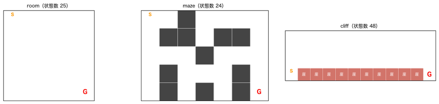

**環境を1歩ずつ動かす**（下・下・右）

```
状態の数: 25  行動: ['上', '右', '下', '左']
スタートの状態: 0 = マス (0, 0)
行動 下 → 状態 5 = マス (1, 0), 報酬 -1.0, ゴール到達 False
行動 下 → 状態 10 = マス (2, 0), 報酬 -1.0, ゴール到達 False
行動 右 → 状態 11 = マス (2, 1), 報酬 -1.0, ゴール到達 False
```

**ランダム方策**（1000回挑戦。1回の上限は200歩）

| 迷路 | 平均リターン | ゴール到達率 | 平均歩数 |
|---|---|---|---|
| room | −90.7 | 0.867 | 90.7 |
| maze | −184.7 | 0.221 | 184.7 |
| cliff | −2096.2 | 0.023 | 198.3 |

**最適方策（矢印）と状態価値（色）**（動的計画法）

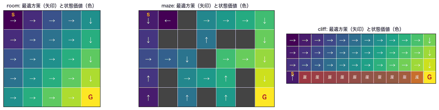

| 迷路 | 最適な価値（スタート） | 最短歩数 | 実際に動かした平均リターン | ゴール到達率 |
|---|---|---|---|---|
| room | −8.0 | 8 | −8.0 | 1.0 |
| maze | −12.0 | 12 | −12.0 | 1.0 |
| cliff | −13.0 | 13 | −13.0 | 1.0 |

**床がすべる（確率0.2）ときの最適方策**

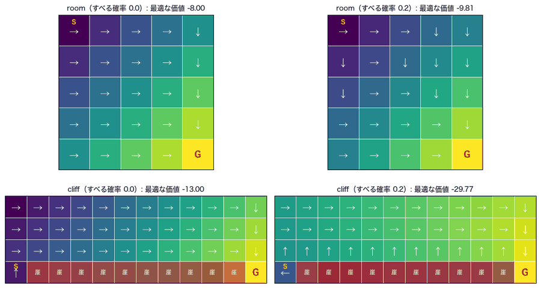

| 迷路 | すべる確率 | 最適な価値 | 実際に動かした平均リターン |
|---|---|---|---|
| room | 0.0 | −8.00 | −8.00 |
| room | 0.2 | −9.81 | −9.89 |
| cliff | 0.0 | −13.00 | −13.00 |
| cliff | 0.2 | **−29.77** | −28.85 |

**ランダム方策の厳密な価値と、シミュレーションの平均**（room）: 厳密（打ち切りなし）**−106.8**、シミュレーション（200歩で打ち切り）**−90.7**。

### 読み取れること
- 強化学習は、**正解の行動を教えられず、報酬から**良い方策を見つける。
- **ランダム方策**は、迷路が難しいほどゴールできない（maze は到達率22%、cliff は2%で、何度も崖に落ちる）。これが学習の**下限**。
- 環境の仕組みを知っていれば、**動的計画法**で**最適方策を厳密に**求められる。**すべらない**ときの最適な価値は、**−最短歩数**と一致する。以降、**学習した方策を、この正解と比べる**。
- 床が**滑る**と、最適な価値が下がり、**方策が変わる**。cliff では、価値が −13 → −29.77 に下がり、**崖から離れた上の2段を進む**ようになる。さらに、**スタートでは「上」ではなく「左」**（壁に押し付けてとどまる）を選ぶ。右の崖へ滑る危険が、全くないため。
- 厳密な価値（−106.8）と、シミュレーションの平均（−90.7）は**違う**。シミュレーションでは**200歩で打ち切る**ため。**評価の条件（打ち切りの有無）で、数字が変わる**ので、条件をそろえて比べる。

### 演習
- `make_env("maze")` を `"room"` に変えて、ランダム方策の到達率と平均歩数を比べる
- `make_env("cliff", slip=0.2)` の `0.2` を `0.05`・`0.4` に変えて、最適方策（崖からどれだけ離れるか）の変化を見る
- `make_env("maze", step_reward=-0.1, goal_reward=10)` で、報酬の設計を変えても、最適な**ルート**は変わらないことを確かめる
- 自分の迷路を、文字列のリストで作る（`S` と `G` が必要）

---

## 01. 多腕バンディット — [01_bandits.ipynb](01_bandits.ipynb)

**このNotebookのゴール**: 強化学習の核心である**探索と活用**のジレンマを、最も簡単な問題（状態のない、10本の腕）で体験する。探索なし・ε-greedy・UCB・トンプソン抽出を、**後悔**で比べる。

**やること**
1. 「少し試しただけでは、最良の腕は分からない」ことを確かめる
2. 探索の量（ε）を変えて比べる
3. 楽観的な初期値、UCB、トンプソン抽出を試す
4. 環境が時間で変わる場合を試す
5. 当たり外れ（ベルヌーイ）の場合を試す

（すべて、2000個の問題で、各1000回引いた平均。後悔の ± は標準誤差。）

### 実行結果

**各腕を同じ回数ずつ引いて、平均が最大の腕を「最良」と判断したとき、本当に最良だった割合**

| 各腕を引いた回数 | 1 | 3 | 10 | 30 | 100 |
|---|---|---|---|---|---|
| 最良の腕を当てた割合 | 0.430 | 0.611 | 0.745 | 0.856 | 0.923 |

**A. 探索の量ε**（左: 平均の報酬、中: 最良の腕を引いた割合、右: 累積の後悔）

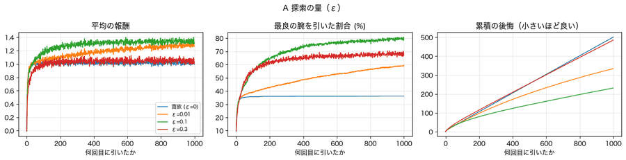

| 手法 | 平均報酬（最後） | 最良の腕の割合（最後） | 累積の後悔（標準誤差） |
|---|---|---|---|
| 貪欲（ε=0） | 1.019 | 0.361 | 500.9（±12.8） |
| ε=0.01 | 1.282 | 0.585 | 334.1（±9.2） |
| **ε=0.1** | **1.341** | **0.794** | **231.4（±2.8）** |
| ε=0.3 | 1.052 | 0.681 | 485.5（±3.4） |

**B. 楽観的な初期値**

| 手法 | 最良の腕の割合 | 累積の後悔 |
|---|---|---|
| 貪欲（初期値0） | 0.361 | 500.9 |
| **貪欲（初期値5）** | 0.701 | **126.1** |
| ε=0.1（初期値0） | 0.794 | 231.4 |

**C. 賢い探索**

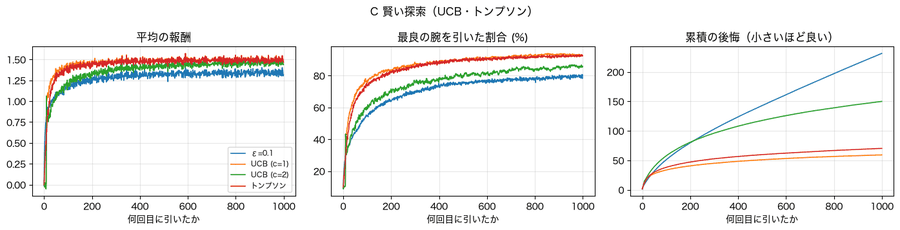

| 手法 | 最良の腕の割合 | 累積の後悔（標準誤差） |
|---|---|---|
| ε=0.1 | 0.794 | 231.4（±2.8） |
| **UCB（c=1）** | **0.932** | **59.3（±0.6）** |
| UCB（c=2） | 0.858 | 150.0（±0.8） |
| **トンプソン** | 0.924 | 70.3（±0.8） |

**D. 環境が変わる（腕の平均が時間で動く。5000回）**

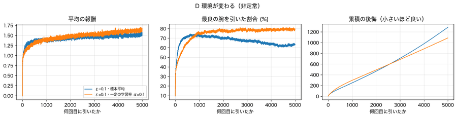

| 手法 | 最良の腕の割合 | 累積の後悔（標準誤差） |
|---|---|---|
| ε=0.1・標本平均 | 0.634 | 1284.3（±11.1） |
| **ε=0.1・一定の学習率 α=0.1** | **0.791** | **1086.3（±6.9）** |

**E. 当たり外れ（ベルヌーイ）**

| 手法 | 最良の腕の割合 | 累積の後悔 |
|---|---|---|
| ε=0.1 | 0.762 | 67.9 |
| UCB（c=1） | 0.657 | 88.7 |
| **トンプソン** | 0.867 | **28.2** |

### 読み取れること
- **少し試しただけでは、最良の腕は分からない**。各腕を1回ずつ引いて選ぶと、当たるのは43%。**100回ずつ引いても92%**で、完全には当たらない（報酬にノイズがあるため）。
- **貪欲（探索なし）**は、最初の運で選んだ腕に**居座り**、最良の腕を引く割合が**36%**で止まる（後悔501）。**探索が多すぎる**（ε=0.3）のも損（後悔485）。**中間（ε=0.1）が最適**（後悔231）。
- **楽観的な初期値**は、最初に全部の腕を試させる簡単な工夫（後悔126）。ただし**最初だけ**。
- **賢い探索**（UCB・トンプソン）は、**不確かな腕だけ**を試すので、後悔が**ε=0.1の約4分の1**（59〜70）。後悔の標準誤差（0.6〜0.8）は、手法間の差よりずっと小さいので、差は誤差ではない。UCBは**cの値に敏感**（c=2で150）。
- **環境が変わる**（非定常）なら、**一定の学習率で、古い情報を忘れる**工夫が効く（後悔1284 → 1086）。標本平均は、古い情報に引きずられる。
- **問題の種類（報酬の分布）で、最良の手法が変わる**。当たり外れの問題では、トンプソンが最良（28）、UCB（c=1）は探索不足（89）。

### 演習
- ε を `[0.02, 0.05, 0.1, 0.2]` に細かく変えて、後悔が最小になる ε を探す
- 楽観的な初期値 `q0=5.0` を `1.0`・`20.0` に変えて、探索の量の変化を見る
- 腕の数を `10` から `50` に増やして、貪欲・ε=0.1・UCBを比べる
- 問題の数 `n_runs=2000` を `20` に減らして、手法の順位が入れ替わることを確かめる（**多くの問題で平均を取る**理由）

---

## 02. Q学習とSARSA — [02_q_learning_sarsa.ipynb](02_q_learning_sarsa.ipynb)

**このNotebookのゴール**: **Q学習**と**SARSA**で、迷路の最適な行動を、**迷路の仕組みを知らずに**（`step()`だけで）学ぶ。崖で2つの方法が**違う方策**を学ぶ理由と、SARSAの**落とし穴**を理解する。

**やること**
1. Q学習が進む様子を、方策の矢印で見る
2. 3つの迷路で、Q学習とSARSAを10シードで学習させる（学習中と学習後を分けて評価）
3. 崖で学習した方策を見る
4. SARSAが学習後に失敗する例と、探索を減らす対策を見る

### 実行結果

**Q学習が進む様子**（maze。1・10・30・100・500エピソード後。矢印＝Qが最大の行動、色＝max Q。0は初期値＝まだ試していない）

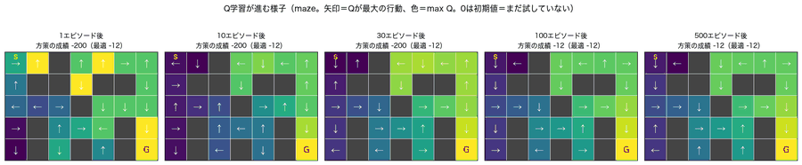

**学習曲線**（10シード。上段＝学習中の成績、下段＝学習後の方策の成績）

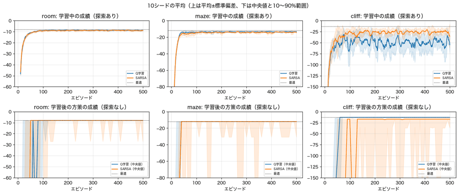

**崖で学習した方策**（上: 最適、中: Q学習、下: SARSA）

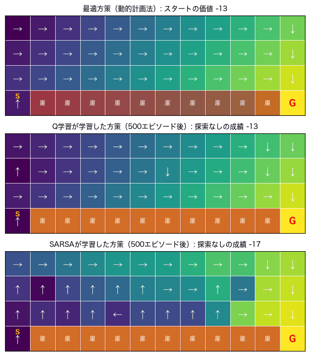

**崖での4つの方法**（10シード）

| 手法 | 学習中の成績（最後100回） | 学習後の方策の成績 | ゴールに着けない方策（シード数） | 崖に落ちた回数/エピソード |
|---|---|---|---|---|
| **Q学習** | **−48.99** | **−13.0**（最適） | 0 | **0.325** |
| **SARSA** | −26.79 | −35.7（1シード失敗） | 1 | 0.046 |
| Q学習（探索を減らす） | −14.93 | −13.0 | 0 | 0.017 |
| SARSA（探索を減らす） | −17.70 | −17.0（安全な遠回り） | 0 | 0.003 |

**SARSAの失敗例**（room。左: 探索率0.1で固定 → 壁に向かう矢印でループし、ゴールに着けない（成績 −200）／ 右: 探索率を0.3→0.01に減らす → ゴール）

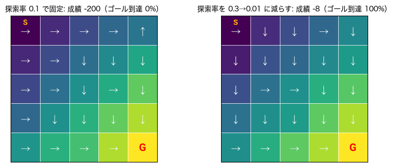

**4つの環境 × 4つの方法**（500エピソード・学習率0.5。学習後の方策の成績は、探索なしで100回）

| 環境 | 手法 | 最適な価値 | 学習中の成績 | 学習後の成績 | 着けない方策 |
|---|---|---|---|---|---|
| room | Q学習 | −8.00 | −8.84 | **−8.00** | 0 |
| room | SARSA | −8.00 | −9.00 | −27.20 | **1** |
| room | Q学習（探索を減らす） | −8.00 | −8.08 | −8.00 | 0 |
| room | SARSA（探索を減らす） | −8.00 | −8.11 | −8.00 | 0 |
| maze | Q学習 | −12.00 | −13.57 | **−12.00** | 0 |
| maze | SARSA | −12.00 | −14.10 | −30.80 | **1** |
| maze | Q学習（探索を減らす） | −12.00 | −12.15 | −12.00 | 0 |
| maze | SARSA（探索を減らす） | −12.00 | −12.17 | −12.00 | 0 |
| cliff | Q学習 | −13.00 | −48.99 | −13.00 | 0 |
| cliff | SARSA | −13.00 | −26.79 | −35.70 | 1 |
| cliff | Q学習（探索を減らす） | −13.00 | −14.93 | −13.00 | 0 |
| cliff | SARSA（探索を減らす） | −13.00 | −17.70 | −17.00 | 0 |
| cliff（すべる0.2） | Q学習 | −29.77 | −61.99 | −42.16 | 0 |
| cliff（すべる0.2） | SARSA | −29.77 | −75.03 | −62.60 | 1 |
| cliff（すべる0.2） | Q学習（探索を減らす） | −29.77 | −34.96 | −33.21 | 0 |
| cliff（すべる0.2） | SARSA（探索を減らす） | −29.77 | −39.90 | −44.69 | 1 |

### 読み取れること
- 学習は、**ゴール付近から、スタートへ向かって**、価値が伝わっていく。10〜30エピソード後は、ほとんどのマスが初期値のまま。**100エピソード後**に、スタートからゴールまでの道筋に**正しい矢印**が並び、最適（−12）に届く。**道筋から外れたマスは、訪れないので、学習されない**。
- **迷路（room・maze）**: 学習中の成績は、最適より少し悪いまま（room −8.84 対 −8）。**探索（ε=0.1）でときどきランダムに動く**ため。学習後は、**Q学習は毎回最適**。
- **崖**: Q学習は**崖沿いの最短ルート**（−13）を学ぶが、**学習中は −49**で、1エピソードに0.33回も崖に落ちる。SARSAは、**探索による事故を価値に反映**して、**崖から離れた遠回り**を学ぶ。学習中は −27（落下0.05回）。**学習中も安全が必要ならSARSA、学習後の最適な方策が欲しいならQ学習**。
- **学習中の成績と、学習後の成績は別**。両方を出さないと、崖でのQ学習の「学習中は悪いが、学習後は最適」が見えない。
- **SARSAの落とし穴**: 探索率を**固定**すると、学習後の方策（探索なし）が、**壁に向かう行動（その場にとどまる）でループ**して、ゴールに着けないことがある（各環境で10シード中1回）。SARSAは**探索を続ける前提**の価値を学ぶので、壁にぶつかり続ける行動も「平均10歩で抜け出せる」と見積もられ、悪くならない。**Q学習は、「次は最良の行動」と仮定するので、このループの価値が下がり続け、避けられる**（失敗0回）。**対策: 学習が進むほど、探索を減らす**（0.3→0.01）。
- **すべる崖（0.2）**は、500エピソード・学習率0.5では、最適（−29.77）に届かない（Q学習で −42、探索を減らして −33）。（**学習率を下げ、エピソードを増やすと解ける**。03・06で確かめる。）

### 演習
- 学習率 `ALPHA = 0.5` を `0.1`・`1.0` に変えて、すべる崖の成績と、SARSAの失敗シード数を見る
- エピソード数 `EPISODES = 500` を `3000` に増やして、すべる崖で最適に近づくか確かめる
- 探索率 `eps=EPS`（0.1）を `0.3`・`0.02` に変えて、崖に落ちた回数と、学習後の成績を見る
- Qの初期値 `q0` を `-50`・`10` に変えて、学習の速さを比べる（**報酬が負なので、`q0=0` は、すでに楽観的**）

---

## 03. 報酬設計・割引率・探索率の落とし穴 — [03_reward_design.ipynb](03_reward_design.ipynb)

**このNotebookのゴール**: 報酬の設計を誤ると、エージェントが**予想外の抜け道**を見つけること（報酬ハッキング）を体験する。報酬が**まばら**なときの対策、**割引率・学習率・探索率**の効き方を知る。

**やること**
1. 繰り返し取れるコインのある迷路で、報酬ハッキングを見る（A）
2. 報酬がまばらな長い一本道で、学習を比べる（B）
3. 割引率を変えた最適方策を比べる（C）
4. 学習率と探索率の組み合わせを調べる（D）

### 実行結果

**A. 報酬ハッキング**（コイン★を踏むたびにボーナス。最適方策・γ=0.99）

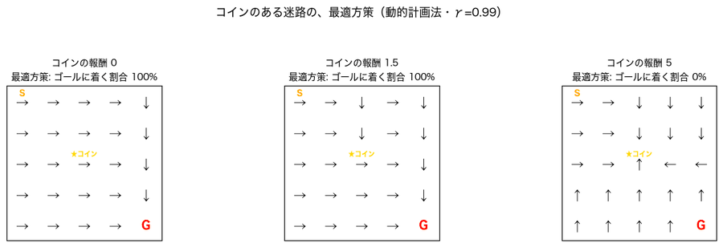

| コインの報酬 | ゴールの報酬 | 最適方策: ゴールに着く | 最適方策: コインを踏む回数 | Q学習: ゴールに着く割合 | Q学習: コインを踏む回数 | Q学習: 平均リターン |
|---|---|---|---|---|---|---|
| 0 | 0 | 1.0 | 0.0 | 1.0 | 0.0 | −8.0 |
| 1 | 0 | 1.0 | 1.0 | 1.0 | 1.0 | −7.0 |
| 1.5 | 0 | 1.0 | 1.0 | 1.0 | 1.0 | −6.5 |
| **2.5** | 0 | **0.0** | 99.0 | **0.0** | 99.0 | 47.5 |
| 5 | 0 | 0.0 | 99.0 | 0.0 | 99.0 | 295.0 |
| 10 | 0 | 0.0 | 99.0 | 0.0 | 99.0 | 790.0 |
| 5 | **500** | 1.0 | 1.0 | 1.0 | 1.0 | 497.0 |

**B. 報酬がまばら**（最短53歩の一本道。ゴールだけ+1。1500エピソード・10シード）

| 報酬の設計 | ゴールできたシード（10中） | 最初にゴールしたエピソード（中央値） | 方策がゴールに着く割合 | 方策の平均歩数（最短53） |
|---|---|---|---|---|
| まばら・Q初期値0 | **1** | 573 | 0.0 | 300 |
| **まばら・Q初期値1（楽観的）** | **10** | **11** | **1.0** | **53** |
| まばら・Q初期値1・割引なし（γ=1） | 1 | 573 | 0.0 | 300 |
| 1歩ごとに−1・Q初期値0（楽観的） | 10 | 11.5 | 1.0 | 53 |
| 1歩ごとに−1・Q初期値−100（悲観的） | 1 | 573 | 0.0 | 300 |
| まばら＋整形（ポテンシャル型）・Q初期値0 | **0** | — | 0.0 | 300 |

整形した報酬: スタートで『右』（ゴールに近づく）**+1.52**、『左』（壁にぶつかってその場にとどまる）**+0.53**。

**C. 割引率γ**（すべる崖0.2・動的計画法）

| γ | 最適な価値V*（スタート） | その方策の実際のリターン（割引なし） | ゴールに着く割合 |
|---|---|---|---|
| 0.1 | −1.11 | **−54.69** | 1.0 |
| 0.5 | −2.00 | −31.85 | 1.0 |
| 0.8 | −4.98 | −30.65 | 1.0 |
| 0.9 | −9.37 | −30.65 | 1.0 |
| 0.99 | −25.48 | −30.65 | 1.0 |
| 1.0 | −29.77 | −30.65 | 1.0 |

**D. 学習率αと探索率ε**（すべる崖0.2・Q学習・1000エピソード。最適 −29.8。色は −80 でカット）

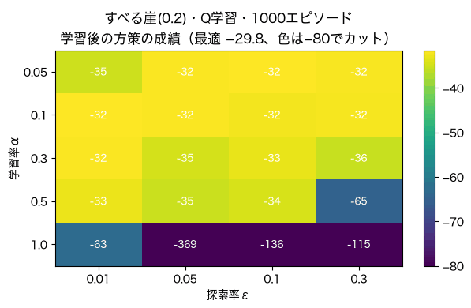

学習後の成績（平均）:

| 学習率α＼探索率ε | 0.01 | 0.05 | 0.10 | 0.30 |
|---|---|---|---|---|
| 0.05 | −35 | −32 | −32 | −32 |
| 0.1 | −32 | −32 | −32 | −32 |
| 0.3 | −32 | −35 | −33 | −36 |
| 0.5 | −33 | −35 | −34 | **−65** |
| 1.0 | **−63** | **−369** | **−136** | **−115** |

シード間のばらつき（sd）:

| 学習率α＼探索率ε | 0.01 | 0.05 | 0.10 | 0.30 |
|---|---|---|---|---|
| 0.05 | 5.7 | 2.4 | 1.8 | 2.5 |
| 0.1 | 2.2 | 1.6 | 2.1 | 2.0 |
| 0.3 | 1.5 | 2.0 | 1.8 | 5.1 |
| 0.5 | 3.6 | 4.9 | 2.2 | 46.8 |
| 1.0 | 48.8 | 649.9 | 84.1 | 36.9 |

### 読み取れること
- **報酬ハッキング**: エージェントは、**報酬を最大化**するだけで、人の意図は知らない。コインの報酬が**2を超える**と、**ゴールせず、コインと隣のマスを往復**する（往復1周期＝2歩で、コイン報酬−2の得）。**最適方策も、Q学習も、同じ抜け道を自分で見つける**。ゴールの報酬を大きく（500）すると、ゴールを選ぶ。**報酬は「人の意図」でなく「測れるもの」で決まる。設計したら、方策を目で見て確かめる**。
- **報酬がまばらだと、学習が進まない**: Q初期値0では、1500エピソードで**ゴールできたのは10シード中1つ**。**楽観的な初期値（1）**にすると、**全シードが約11エピソードでゴール**する。**割引なし（γ=1）だと、楽観的でなくなり、効かない**。「1歩ごとに−1」が効くのも、実は**Q=0が楽観的**だから（悲観的な −100 にすると失敗）。**効いていたのは、「毎歩の罰」より「初期値の楽観」**。
- **ポテンシャル型の整形は、助けにならなかった**（1シードもゴールできない）。γ<1の整形では、**その場にとどまるだけで、+0.53**の報酬が出る（進むと+1.52）。ゴールを知らない学習初期には、区別できない。また、整形は各状態の全行動に**同じ値を足す**だけなので、**行動の順位は変わらない**。**理論上安全でも、学習が速くなるとは限らない**。
- **割引率**: 最適な価値は、γで大きく変わる（−29.77 → −1.11）が、**方策は、γ≧0.8では同じ**（実際のリターン −30.65）。**γが小さすぎる**（0.1）と、**近視眼的**になり、危険な近道を選ぶ（−54.69）。
- **学習率**: **大きい（0.5〜1.0）と不安定**（α=1.0で −63〜−369、sdは数十〜数百）。**小さい（0.05〜0.3）と、比較的安定**（−32〜−36、sdは多くが2前後）。探索率は、学習率ほど効かない。**確率的な環境では、学習率を小さく**する。02で届かなかったすべる崖は、**学習率が大きすぎた**ため。

### 演習
- コインの報酬のリストに `(2, 0)`・`(2.2, 0)` を足して、ハッキングの境目（2）の前後で方策が変わることを確かめる
- `(5, 500)` を `(5, 50)`・`(5, 200)` にして、ゴールを選ぶ最小のゴール報酬を探す
- 楽観的な初期値 `q0=1.0` を `0.3`・`3.0` にして、ゴールまでのエピソード数を比べる
- `exp_d` の `episodes=1000` を `5000` にして、α=0.05・0.1 が最適（−29.8）に近づくか確かめる

---

## 04. 深層強化学習（DQN）— [04_dqn.ipynb](04_dqn.ipynb)

**このNotebookのゴール**: 状態が**連続**（小数）で、Q表に収まらない問題を、**ニューラルネットワーク**で解く（DQN）。**経験再生**と**ターゲットネットワーク**が、なぜ必要かを、外して確かめる。

**やること**
1. CartPole（棒立て。満点200）を、ランダムとルールで動かす
2. ルール・離散化した表形式・DQN（再生/ターゲットの有無・安定化の工夫）を、10シードで比べる
3. 学習曲線を見る
4. ターゲットなしで、Q値が発散することを確かめる

### 実行結果

**CartPoleの棒の角度**（5回ずつ。±12度で倒れる。左: ランダム、右: ルール）

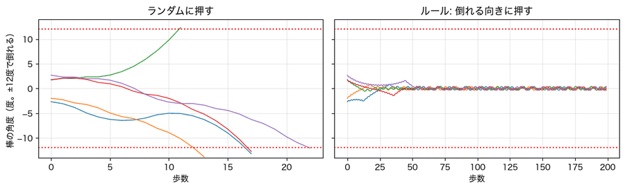

**ルール・離散化・DQN（再生/ターゲットの有無）**（10シード・探索なし・最後の3回の評価の平均。満点200）

| 手法 | 評価 | sd | 最大 | 満点に達したシード | 最大から落ちた幅 |
|---|---|---|---|---|---|
| ランダム | 25.5 | — | — | — | — |
| ルール（倒れる向きに押す） | **200.0** | — | — | — | — |
| **離散化した表形式Q学習**（2000エピソード） | **182.1** | 19.4 | 200.0 | 10 | 21.6 |
| **DQN**（再生あり・ターゲットあり、300エピソード） | **151.7** | 51.6 | 200.0 | 10 | **73.0** |
| DQN（学習率を下げ、ターゲット更新を遅く） | 165.7 | 21.9 | 195.0 | 6 | 33.0 |
| 再生なし | **10.1** | 0.9 | 38.1 | 0 | 28.1 |
| ターゲットなし | **9.5** | 0.3 | 9.5 | 0 | 0.0 |
| 再生もターゲットもなし | 9.5 | 0.3 | 9.6 | 0 | 0.1 |

**学習曲線**（左: 学習後の方策の成績、中: DQNの学習中と学習後、右: 2つの工夫を外したとき）

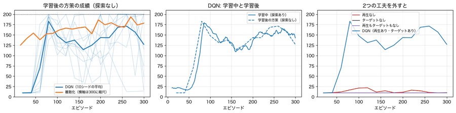

**直立のときのQ値**（γ=0.99。理論上の上限 1/(1−γ)=100）

| 手法 | Q(左) | Q(右) |
|---|---|---|
| DQN（再生あり・ターゲットあり） | 102.0 | 99.6 |
| ターゲットなし | **84,107** | **55,801** |
| （参考）理論上の上限 | 100.0 | 100.0 |

### 読み取れること
- **ランダム**は20〜30歩で倒れるが、**ルール**（棒が倒れる向きに押す）は**満点（200）**。この問題は、ルールで簡単に解ける。ルールは、**満点の基準**として使う。
- **離散化した表形式Q学習**は、連続の状態を324通りに区切るだけで、**10シード全部が満点に達し**、安定した（182.1）。
- **DQN**は、10シード全部が**一度は満点**に達するが、**そのまま保てず**、最大から平均73落ちる（151.7、±51.6）。約80エピソードで平均が約183に達した後、約115まで下がり、**上下を繰り返す**。満点から30以下まで落ちるシードもある。（推測: 良い方策になると、箱に倒れない遷移ばかりがたまり、倒れる場面の価値を**忘れる**。）
- **経験再生・ターゲットは、両方必須**。外すと**学習が崩壊**する（10.1・9.5。ランダムの25より悪い）。
- **ターゲットなしでは、Q値が数万に発散**する（84,107）。理論上の上限（100）の**800倍以上**。目標を、学習中のネットワーク自身で計算すると、**更新のたびに目標も動き**、近い状態は似た出力になるので、**追いかけっこで値が膨らむ**。ターゲットネットワークは、これを止める。**関数近似×ブートストラップ×古いデータ（オフポリシー）の3つがそろうと発散しやすい**（「死の三つ組」）。
- 学習率を下げ、ターゲット更新を遅くすると、**ばらつきが小さく**なる（51.6→21.9）が、満点に達したシードは**6/10に減る**。**安定と引き換えに、頂点が低くなる**ようだ。
- ⚠ **この Notebook の順位（離散化 > DQN）は、このシードの組の結果**。**最終評価（06）では逆転**し（離散化 158.9・DQN 172.1）、差は誤差の範囲だった。**正しくは「この問題で、DQNと離散化は、同程度」**。**1回の実験の順位を、結論にしない**。

### 演習
- `run_phase4.EPISODES = 300` を `600` にして、DQNの「最大から落ちた幅」がどう変わるか見る（約7分）
- 経験再生の箱 `buffer=10_000` を `1_000`・`50_000` にして比べる（**ただし、少ないシードでの優劣は、運を含む**）
- ターゲットの更新頻度 `target_every=200` を `20`・`2000` にして、Q値の暴れ方と学習の速さを見る
- 離散化の境目 `EDGES` を粗くして、表形式Q学習の成績がどう変わるか見る

---

## 05. 蓄電池の充放電制御 — [05_battery.ipynb](05_battery.ipynb)

> 🔒 すべて**合成データ**（自作のシミュレータ）です。

**このNotebookのゴール**: これまでの手法を、**実問題に近い設定**（家庭用蓄電池の充放電）に当てはめる。**何もしない／ルール／動的計画法（最適）／Q学習**を、電気代（円/日）で比べ、強化学習が**役に立つ場面と、そうでない場面**を数字で知る。

**設定**: 容量6kWhの蓄電池（1時間に1kWh、効率は片道0.9）。電気料金は、夜（0〜6時）15円・昼（7〜16時）28円・夕方（17〜22時）40円・23時28円（買電）／売電8円。状態＝時刻・蓄電量・天気予報（晴・曇・雨。10%の確率で外れる）、行動＝待機・充電・放電、報酬＝−電気代。

**やること**
1. 料金・発電量・需要を見る
2. 最適方策とルールの行動を比べる
3. 晴れの日・雨の日を、1日動かす
4. 4つの方法を、365日の電気代で比べる
5. Q学習の学習の速さ、天気予報の価値、割引率の影響を調べる

### 実行結果

**電気料金と、1日の発電量・需要**

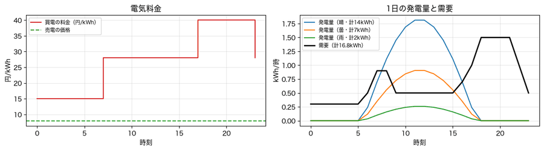

**各状態でとる行動**（灰＝待機、青＝充電、橙＝放電。上: 最適方策、下: ルール。左から、予報が晴・曇・雨）

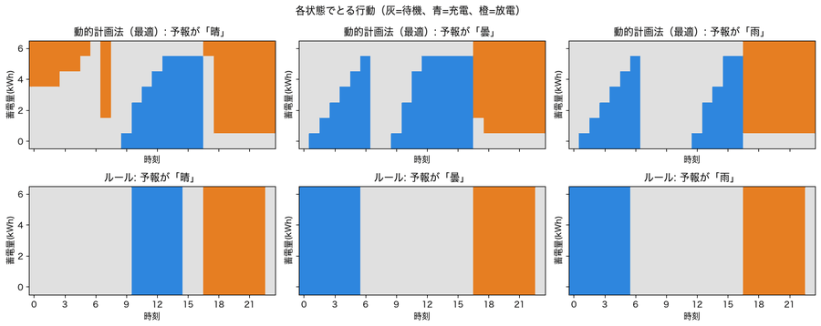

**晴れの日・雨の日を1日動かす**（蓄電量の変化。凡例は、その日の電気代）

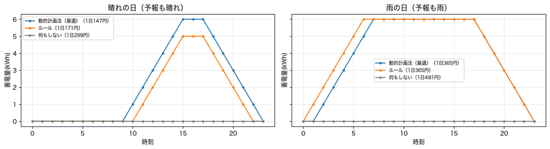

**4つの方法の比較**（予報の外れ率10%・365日）

| 方法 | 電気代（円/日） | ばらつき（sd） | 何もしないとの差 |
|---|---|---|---|
| 何もしない（蓄電池なしと同じ） | 369.6 | — | 0 |
| ルール（夜に充電・夕方に放電） | 251.1 | — | 118.4 |
| **動的計画法（最適）** | **241.8** | — | **127.8** |
| Q学習（1500エピソード） | 253.3 | 8.6 | 116.2 |

**Q学習の学習の速さ**（1回のエピソード＝30日ぶん。10シード）

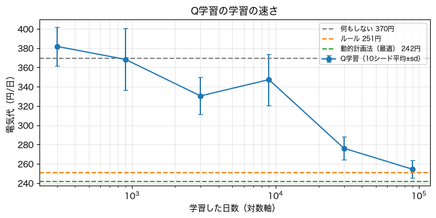

| 学習エピソード数 | 学習した日数 | 電気代（円/日） | ばらつき（sd） |
|---|---|---|---|
| 10 | 300 | **381.8** | 20.1 |
| 30 | 900 | 368.3 | 32.2 |
| 100 | 3,000 | 330.4 | 19.2 |
| 300 | 9,000 | 347.3 | 26.6 |
| 1000 | 30,000 | 276.1 | 11.8 |
| 3000 | **90,000** | **254.4** | 9.1 |

**天気予報の価値**（実際の外れ率の環境で評価。2/3＝当てずっぽう）

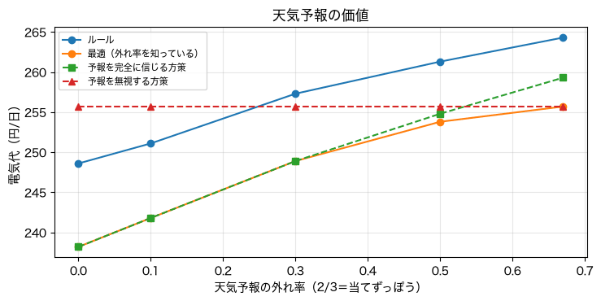

| 予報の外れ率 | ルール | 最適（外れ率を知っている） | 予報を完全に信じる方策 | 予報を無視する方策 |
|---|---|---|---|---|
| 0.00 | 248.6 | **238.2** | 238.2 | 255.7 |
| 0.10 | 251.1 | 241.8 | 241.8 | 255.7 |
| 0.30 | 257.3 | 248.9 | 248.9 | 255.7 |
| 0.50 | 261.3 | 253.8 | 254.8 | 255.7 |
| 0.67 | 264.3 | **255.7** | 259.3 | 255.7 |

**割引率（先を見る長さ）の影響**（動的計画法の最適方策）

| 割引率γ | 先を見る長さ（時間） | 最適方策の電気代（円/日） |
|---|---|---|
| 0.5 | 2 | **369.6**（何もしないのと同じ） |
| 0.8 | 5 | 350.0 |
| 0.9 | 10 | 315.5 |
| 0.95 | 20 | 283.8 |
| 0.98 | 50 | **241.8** |
| 0.995 | 200 | 241.8 |

### 読み取れること
- 料金は**夜が安く（15円）夕方が高い（40円）**。**夜に蓄えて夕方に使う**と、効率の損を引いても得。**晴れの日は昼に発電が余り**、**雨の日はほとんど発電しない**。
- **最適方策**は、夕方（17〜22時）に**放電**し、**予報で行動を変える**。曇・雨の予報では**夜に充電**、**晴れの予報では夜に充電せず、昼に余る発電を蓄える**（蓄電量が多いと、夜にむしろ放電して空きを作る）。昼にも、蓄電量が少なければ充電する（昼28円→夕方40円でも、約5円/kWh得）。**ルールは、蓄電量を見ず、決まった時刻に動く**。
- 晴れの日の電気代は、最適**147円**・ルール**171円**・何もしない299円。雨の日は、最適とルールが**同じ動き（365円）**。**差が出るのは、晴れの日の昼の使い方**（余った発電を、どれだけ上手に蓄えるか）。
- **ルールだけで、最適の節約の約93%**（118.4/127.8）。最適はルールを約4%（9円/日）上回る。**モデルなしのQ学習は、ルールに並ぶのが精一杯**（253.3、sd 8.6）。
- **Q学習は、学習に時間がかかる**: **300日ぶんの経験では、何もしないより悪い**（381.8円 対 369.6円）。ルールに並ぶ（254円）のは、**9万日ぶん（約250年）**の経験から。実際の家で1年（365日）しか経験できないなら、**ゼロからの学習は非現実的**。シミュレータや過去のデータで学ぶ。途中（100→300エピソード）の悪化は、学習のぶれ（sdが20〜30円）。
- **天気予報の価値**: 外れ率0で238.2円、当てずっぽうで255.7円。**約17円/日（約7%）**。予報を無視する方策は、常に255.7円。**予報を完全に信じる方策**は、外れ率が小さいうちはほぼ最適と同じだが、**外れ率が大きいと損**（67%で259.3円）。**外れ率を過小評価すると損**をする。
- **割引率**: γ=0.5（約2時間先）では、**何もしないのと同じ**（369.6円）。夜の充電を夕方に使うには、**約15時間以上先を見る必要**がある。**小さすぎると、意味のある行動が学べない**（03と同じ教訓）。
- 注意: **合成データのおもちゃの例**。蓄電池の導入費用・劣化・実際の需要の変動・料金の変更は含めない。節約額から、実際の経済性は判断できない。

### 演習
- `BUY` の夕方（17〜22時）の料金を `40` から `30` に変えて、最適とルールの差を見る
- 蓄電池の容量 `capacity=6` を `3`・`12` にして、電気代を比べる
- `rule_policy` の時刻や条件を変えて、**ルールを最適（241.8円）に近づける**
- Q学習の学習率 `alpha=0.2` を `0.05`・`0.5` にして、ばらつきと平均を見る
- `exp1(e=0.5)` で、予報が当たらない環境の差を見る

---

## 06. 評価・再現性・最終レポート — [06_final_report.ipynb](06_final_report.ipynb)

**このNotebookのゴール**: 強化学習の評価で**守るべき約束**を、実際の結果で確認する。**最終評価（test）**の結果を読み、**04の結論を見直す**。**再現性**（同じシードなら同じ結果）と**ばらつき**を確かめる。

**評価の約束**: ①学習中と学習後を区別 ②複数シード（10）の平均とばらつき ③ハイパーパラメータは**開発用のシード**（2M番台）で選ぶ ④**最終評価（3M番台）は1回だけ**。結果を見て設定を変えない ⑤後から選んだ最高値でなく、**最後の方策**で評価 ⑥基準（ランダム・ルール・最適）と比べる

> このNotebookは、`select_dev.py` と `final_eval.py` が保存した結果（`outputs/final/`）を読みます。**保存済みの結果がない環境では、最初のセルでエラー**になります。

### 実行結果

**開発用シード（5つ）で選んだ設定**

| DQNの候補 | 最後の3回の平均 | 選んだ |
|---|---|---|
| 既定（lr1e-3・ターゲット200・箱1万・300回） | 175.8 | |
| **安定重視（lr3e-4・ターゲット1000・300回）** | **182.9** | ◎ |
| 箱を大きく（5万・300回） | **118.7** | |
| 安定重視＋箱5万＋600回 | 103.5 | |

表形式の学習率（正規化した成績。1＝最適）: Q学習は α=0.05・0.1 で **1.000**、0.3・0.5 で 0.999。SARSAは α=0.05・0.1 で 0.999、0.3 で 0.998、**0.5 で 0.986**。蓄電池のQ学習の学習率（電気代）: α=0.05 は 282.1円、**α=0.2 は 252.6円**（選択）。

**最終評価（test）**: 学習3.0M番台の10シード・評価3.1M。**1回だけ**。

| 課題 | 手法 | 平均 | sd | 正規化 |
|---|---|---|---|---|
| maze | ランダム | −183.9 | — | 0 |
| maze | 最適（動的計画法） | −12.0 | — | 1 |
| maze | Q学習 / SARSA（探索を減らす） | −12.0 / −12.0 | 0 / 0 | 1.000 / 1.000 |
| cliff | ランダム | −2070.3 | — | 0 |
| cliff | 最適 | −13.0 | — | 1 |
| cliff | Q学習 / SARSA | −13.0 / **−15.0**（安全な遠回り） | 0 / 0 | 1.000 / 0.999 |
| cliff（すべる0.2） | 最適 | −29.77 | — | 1 |
| cliff（すべる0.2） | Q学習 / SARSA | **−30.25 / −30.98** | 1.6 / 2.6 | 1.000 / 0.999 |
| CartPole | ランダム | 22.3 | — | — |
| CartPole | ルール | **200.0** | — | — |
| CartPole | 離散化した表形式Q学習 | 158.9 | 44.2 | （満点近く 3/10） |
| CartPole | DQN（最後のネットワーク） | 172.1 | 27.3 | （満点近く 3/10） |
| 蓄電池（円/日） | 何もしない | 351.9 | — | 節約0 |
| 蓄電池 | ルール | 232.8 | — | 節約0.912 |
| 蓄電池 | 動的計画法（最適） | **221.3** | — | 1 |
| 蓄電池 | Q学習 | 234.6 | 8.2 | 約0.90 |

**予行演習（val）と最終評価（test）の比較**

| 課題 | 手法 | 平均（val） | 平均（test） | sd（val） | sd（test） |
|---|---|---|---|---|---|
| cliff（すべる0.2） | Q学習 | −30.70 | −30.25 | 0.71 | 1.64 |
| cliff（すべる0.2） | SARSA | −31.76 | −30.98 | 1.46 | 2.56 |
| CartPole | 離散化した表形式Q学習 | **187.44** | **158.86** | 21.45 | 44.23 |
| CartPole | DQN | 168.34 | 172.10 | 27.83 | 27.32 |
| 蓄電池 | Q学習 | 243.59 | 234.56 | 5.35 | 8.16 |

**差は、本当にあるのか**（標準誤差＝sd÷√10。差÷標準誤差が2未満なら、区別できない）

| 課題 | 比較 | 平均の差 | 差の標準誤差 | 差÷標準誤差 | 判定 |
|---|---|---|---|---|---|
| CartPole | DQN − 離散化 | 13.2 | 16.4 | 0.8 | **区別できない** |
| 蓄電池 | Q学習 − ルール | 1.8 | 2.6 | 0.7 | **区別できない** |

**再現性**（すべる崖のQ学習。評価シード 3100000）

```
同じシード（3000000）で2回: -29.34 -29.34 → 同じ
シードを変える: [-29.34, -33.2, -29.34, -33.78, -29.34] → ばらつく
```

### 読み取れること
- **ハイパーパラメータの優劣は、シードでひっくり返る**。04のあと、別の6シードの予備実験では、「箱を大きく（5万）」が約170と**良く見えた**。ところが、新しい開発用シードでは**118.7と悪く**、選ばれなかった。**少ないシードで「効いた」と思った工夫が、運だった**ことがある。
- **表形式（迷路・崖）は、Q学習もSARSAも、ほぼ最適**（正規化 約1.000）。02で届かなかった**すべる崖**が解けたのは、**学習率を下げ（0.5→0.05）、探索を減らし、エピソードを増やした**（500→2000）ため。**手法の限界と、設定の不備を混同しない**。
- **CartPoleは、10シードでも、大きくぶれる**。離散化は 187（val）→ 159（test）、DQNは 168 → 172。**平均が約30動く**（sdが27〜44）。
- **差を標準誤差と比べる**と、**DQNと離散化は、区別できない**（差13、標準誤差16）。**04で「離散化のほうが強い」と書いたのは、強すぎた**。正しくは「**同程度。どちらもルール（満点）には及ばない**」。
- **蓄電池**は、**Q学習とルールが区別できない**（差1.8円/日、標準誤差2.6）。「Q学習は、ルールに**並ぶ**」が正確（超える・下回るとは言えない）。ルールと最適の差（約11円/日）は、同じ天気の並びでの比較なので、方策の差。
- **再現性**: **同じシードなら、完全に同じ結果**（固定したシードで再現できる）。**シードを変えると変わる**（5つのうち3つは −29.34 に落ち着き、2つは −33台）。再現性は「**同じ条件の再実行**」を保証するだけで、**結論の一般性**は、複数シード・基準との比較で確かめる。
- **後から選んだ最高値（評価の最大）は、実力ではない**。最後のネットワーク・方策で評価する。

### 演習
- `SPLITS["val"]["train_seeds"]` を10個から30個にして、CartPoleの平均とsdが安定するか、順位がはっきりするかを見る
- 評価の「最後の3回の平均」の代わりに「最大」を使った表と比べて、最高値が実力より良く見えることを確かめる
- `select_dev.py` の `DQN_CANDIDATES` に、自分の設定（隠れ層の大きさなど）を足して、選ばれるか見る（**最終評価（test）は、もう使えない**。再評価は、新しいシードで）
- DQNがルール（200）に届かない理由を、考える（エピソード数・探索率・報酬の設計）

---

## まとめ — 7本を通して分かること

1. **探索と活用**: 探索は多すぎても少なすぎても損。**賢い探索**（UCB・トンプソン）は、後悔が約4分の1。**楽観的な初期値**は、簡単な探索の工夫。
2. **学習中と学習後は別**: 崖で、Q学習は**学習中は −49、学習後は −13**。**オフポリシー**は最適な方策を、**オンポリシー**は探索込みの安全な方策を学ぶ。**SARSAは、探索なしで失敗**することがある（探索を減らして解消）。
3. **報酬は、測れるものでしか決まらない**: コインの報酬が2を超えると、**ゴールせず往復**する。まばらな報酬には**楽観的な初期値**。**理論上安全な報酬整形も、学習が速くなるとは限らない**。
4. **割引率**は、**先をどれだけ見るか**を決める。小さすぎると近視眼的（蓄電池では、γ≦0.5で何もしないのと同じ）。**学習率**は、確率的な環境では小さく。
5. **DQNは万能ではない**: 再生・ターゲットは**両方必須**（外すとQ値が発散）。**不安定**で、**簡単な方法（ルール・離散化）にも並ばれる**。
6. **ルールが強い**: 蓄電池で、ルールだけで最適の節約の約91〜93%。**モデルなしのQ学習は、ルールに並ぶのに9万日ぶんの経験が必要**で、現実の家で、ゼロから学習するのは非現実的。
7. **評価の約束を守る**: **複数シード・標準誤差**で差を判断。**学習中と学習後を区別**。**設定は開発用のシードで選び、最終評価は1回だけ**。**後から選んだ最高値は使わない**。それでも、**ハイパーパラメータの優劣は、シードでぶれ**、**1回の実験の順位は、最終評価で入れ替わる**。**結論は、控えめに書く**。
